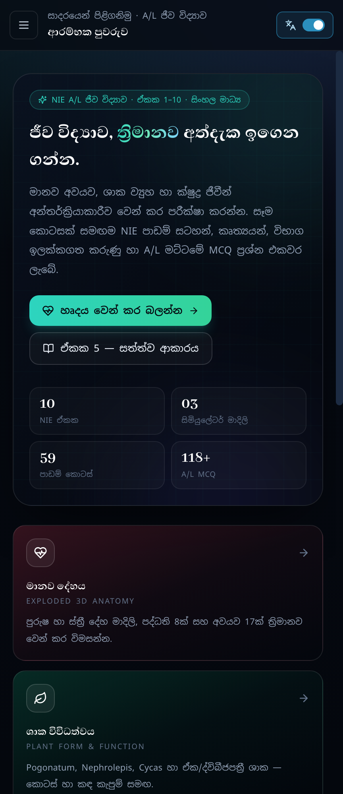
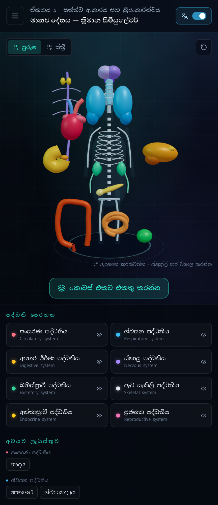
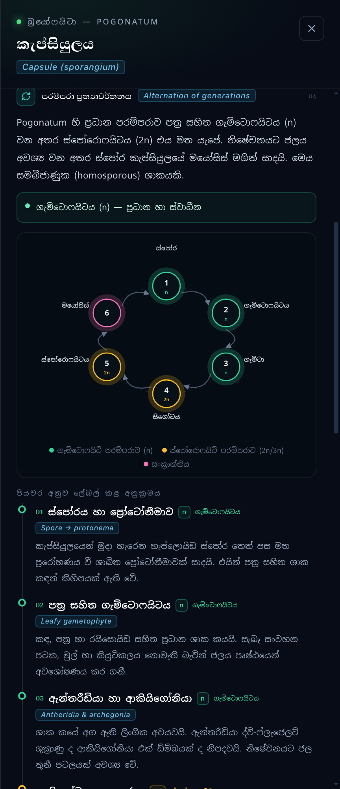

# ජීව විද්‍යා මණ්ඩපය · A/L Biology Interactive

A Sinhala-medium interactive laboratory for Sri Lankan G.C.E. A/L Biology, organised around the NIE Units 1–10 syllabus. Every view links back to exam-focused Sinhala notes and A/L-style MCQs.



## What's inside

- **Exploded 3D anatomy** — male/female body, 8 organ systems and 17 organs with animated separation, camera fly-to, system filters and clickable organs.
- **Plant diversity** — *Pogonatum*, *Nephrolepis*, *Cycas*, monocot and dicot, with animated part separation, interactive labels and a stem cross-section view.
- **Organisms & microbes** — bacteria, *Amoeba*, *Euglena*, *Paramecium*, *Rhizopus*, earthworm and tilapia with clickable structures and a five-kingdom reference.
- **Study drawer** — හැඳින්වීම සහ පිහිටීම · ව්‍යුහය · කෘත්‍යයන් · විභාග ඉලක්කගත කරුණු plus two explained MCQs per entry.
- **Alternation of generations** — dedicated life-cycle sections with a circular stage diagram, ploidy/generation labels and exam key points for *Pogonatum*, *Nephrolepis*, *Cycas* and angiosperms (monocot & dicot).
- **Bilingual terms** — English scientific terms shown inline or on hover from the top-bar toggle.





## Run locally

```bash
npm install
npm run dev
```

Vite serves on `http://localhost:3000`.

```bash
npm run build     # production build
npm run preview   # preview the production build
```

## Stack

Vite · React 18 · TypeScript · Tailwind CSS · Framer Motion · React Three Fiber / drei · Lucide

## Content

- 17 human organs across 8 systems
- 5 plant specimens / 21 plant parts
- 7 organisms / 21 organism parts
- 59 study entries and 118+ MCQs
- 4 authored life cycles (angiosperm cycle shared by monocot and dicot)

Content lives in `src/data/` (`anatomy/`, `plants/`, `organisms/`, `lifecycles/`, `units.ts`); 3D scene code in `src/three/`, interactive SVG art in `src/art/`, and UI in `src/components/`.

The 3D models are stylised primitive-based teaching models, not clinical scans.
